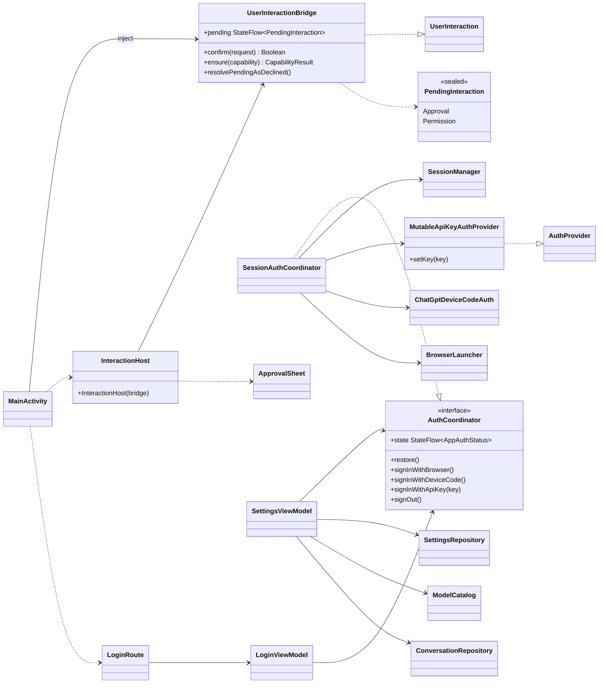
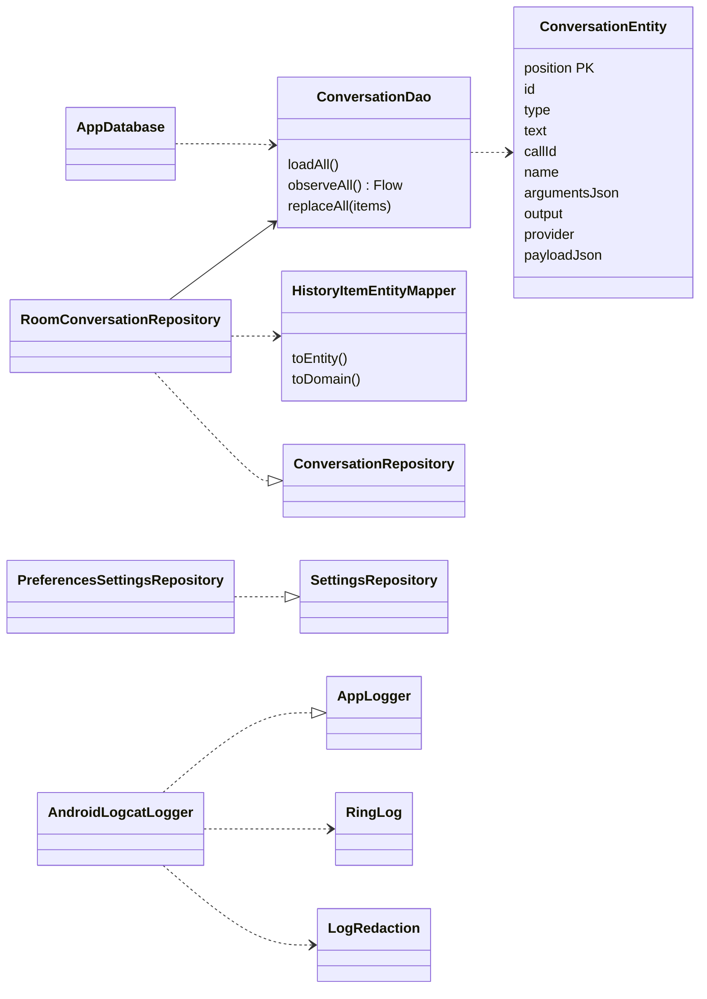

# Карта архитектуры: `:app`, мост диалогов, вход, хранилище, логи

> Снимок 2026-09-24: `файл:строка` устарели (T8, T9, «Стык»). Верить коду и [overview](overview.md).

> Карта: [обзор](map-overview.md) · [ядро](map-core-data.md) · [вход](map-auth.md) · [tools и UI](map-tools-app.md) · **app: мост, вход, хранилище** · [потоки](map-flows.md). Раньше: [adapters](adapters.md). DI-модули: в [обзоре](map-overview.md).

## Пакеты `:app`

| Пакет (`com.example.phoneagent.`) | Файлов | Что внутри |
|---|---|---|
| корень | 2 | `PhoneAgentApplication`, `MainActivity` |
| `auth` | 2 | `AuthCoordinator`, `AppAuthStatus`, `SessionAuthCoordinator`, `MutableApiKeyAuthProvider`, `ApiKeyAuthFactory` |
| `data.storage` | 1 | `PreferencesSettingsRepository` (DataStore) |
| `storage` | 5 | Room: `AppDatabase`, `ConversationDao`, `ConversationEntity`, `HistoryItemEntityMapper`, `RoomConversationRepository` |
| `interaction` | 1 | `UserInteractionBridge`, `PendingInteraction` |
| `logging` | 2 | `AndroidLogcatLogger`, `crashLoggingHandler` |
| `di` | 5 | 11 Hilt-модулей ([обзор](map-overview.md)) |
| `ui.chat`, `ui.designsystem`, `ui.login`, `ui.settings`, `ui.interaction`, `ui.navigation` | 11, 28, 4, 6, 1, 1 | экраны, компоненты, `InteractionHost`, `AppNavigation` |

Хранилища разложены по двум пакетам: настройки в `data.storage`, история в `storage`. Мост диалогов тоже в двух: `interaction` (логика) и `ui.interaction` (Compose).

Область ViewModel: экраны берут `hiltViewModel()` внутри `NavEntry`, а артефакта `lifecycle-viewmodel-navigation3` в `app/build.gradle.kts` нет. Значит ViewModel может жить на уровне Activity, а не записи стека: `ChatViewModel` и `SettingsViewModel` не пересоздаются при выходе с экрана, а `ChatViewModel` переживает выход из аккаунта `[проверить]`.

## Мост диалогов, вход, настройки

| Тип | Ответственность |
|---|---|
| `UserInteractionBridge` | `@Singleton`, реализует порт ядра. Кладёт вопрос в один слот `StateFlow` и ждёт `CompletableDeferred`; `finally` снимает слот, если он свой |
| `InteractionHost` | Корневой composable: показывает `ApprovalSheet` либо запускает системный запрос разрешений; уход из композиции = отказ. `Capability` → Android: `NOTIFICATIONS` = `POST_NOTIFICATIONS` (с API 33), `FILES` = `READ_MEDIA_*` или `READ_EXTERNAL_STORAGE`; `Available`, если выдано хоть одно |
| `SessionAuthCoordinator` | Фасад для UI над `SessionManager`; сводит его состояния в `AppAuthStatus` через `combine(...).stateIn(applicationScope, Eagerly)`; открывает страницу device code |
| `MutableApiKeyAuthProvider` | Провайдер `API_KEY` в общей карте: ключ кладётся полем `pendingKey`, затем `signIn()` создаёт `ApiKeyAuth` через `ApiKeyAuthFactory` и стирает поле |
| `LoginViewModel`, `LoginRoute` | `AuthCoordinator.state` → `LoginUiState`; `restore()` в `init`; `LoginRoute` показывает `AppNavigation` при `isSignedIn`, поле API-ключа не сохраняется в `Bundle` |
| `SettingsViewModel` | Три параллельных `launch` в `init` (статус входа, каталог моделей, настройки); запись настроек под `Mutex`; `clearHistory()` = `replace(emptyList())`; выход |
| `SettingsRoute` | Выбор папки `OpenDocumentTree` + `takePersistableUriPermission`, затем `SaveSearchFolder(uri)` |

## Хранилище и логи

| Тип | Ответственность |
|---|---|
| `AppDatabase`, `ConversationEntity`, `ConversationDao` | Room v1, `exportSchema=false`, одна таблица `conversation_history`; ключ = позиция; `replaceAll` = `@Transaction` (delete, затем insert) |
| `HistoryItemEntityMapper` | `HistoryItem` ↔ строка по дискриминатору `type`; неизвестный тип или пустое обязательное поле бросает исключение |
| `RoomConversationRepository` | Порт ядра поверх DAO; `observe()` = `observeAll().map` |
| `PreferencesSettingsRepository` | `AppSettings` в DataStore `app_settings`; `null` = удалить ключ |
| `AndroidLogcatLogger` | Logcat плюс кольцевой файл `noBackupFilesDir/app.log` (64 КБ): каждый вызов читает и переписывает файл целиком под `synchronized`, на потоке вызывающего. Всегда за `RedactingAppLogger` |
| `crashLoggingHandler` | Пишет необработанное исключение в лог, затем зовёт прежний обработчик |
