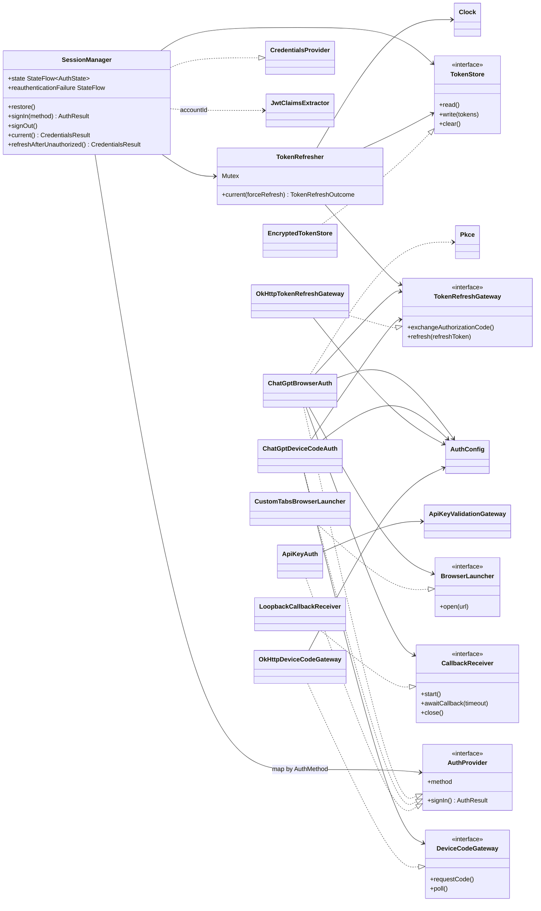

# Карта архитектуры: вход и токены (`:data:auth`)

> Снимок 2026-09-24: `файл:строка` устарели (T8, T9, «Стык»). Верить коду и [overview](overview.md).

> Карта: [обзор](map-overview.md) · [ядро](map-core-data.md) · **вход `:data:auth`** · [tools и UI](map-tools-app.md) · [app](map-app-infra.md) · [потоки](map-flows.md). Раньше: [adapters](adapters.md).

Модуль Android library: DataStore, Keystore, Custom Tabs, `ProcessLifecycleOwner`. Зависит только от `:core:domain`. Наружу отдаёт `CredentialsProvider` (реализует `SessionManager`), остальные типы читает `:app`.

| Тип | Ответственность |
|---|---|
| `SessionManager` | Фасад входа: держит `AuthState`, выбирает `AuthProvider` по `AuthMethod`, пишет токены в `TokenStore`, отдаёт `CredentialsProvider` клиенту модели, публикует `reauthenticationFailure` |
| `TokenRefresher` | Чтение и refresh под `Mutex` (single-flight), окно 30 с до истечения; `invalid_grant` очищает хранилище и даёт `NeedsSignIn` |
| `TokenStore`, `EncryptedTokenStore` | DataStore `auth_tokens`, AES-GCM, ключ AndroidKeyStore; ошибка чтения = «вышел», в лог только класс исключения |
| `ChatGptBrowserAuth` | PKCE, Custom Tab, loopback `127.0.0.1:1455`, проверка `state`, перед обменом кода ждёт foreground процесса, таймаут 3 мин |
| `ChatGptDeviceCodeAuth`, `OkHttpDeviceCodeGateway` | Device code: запрос кода, опрос с интервалом, таймаут 15 мин; `prompt: StateFlow` для UI (оба класса в одном файле) |
| `ApiKeyAuth` | Проверка ключа через порт ядра; ключ хранится как `accessToken`, без refresh |
| `OkHttpTokenRefreshGateway` | `POST` в token endpoint: обмен кода и refresh; два повтора (500 и 1500 мс) при `IOException`; `invalid_grant` = `InvalidGrant` |
| `AuthConfig` | Константы OAuth (`issuer`, `clientId`, `redirectUri`, `scope`); адреса device code выводятся из `issuer` |
| `Pkce`, `JwtClaimsExtractor` | Чистые функции: verifier, challenge, state; `exp` и `chatgpt_account_id` из JWT без проверки подписи |
| `AuthState`, `AuthMethod`, `AuthFailure`, `AuthResult`, `AuthTokens` | Модели входа. `AuthTokens.toString()` и `AuthFailure.Network` прячут секреты и текст ошибки |
| `LoopbackCallbackReceiver`, `CustomTabsBrowserLauncher` | Тонкие Android-обёртки (сокет, Custom Tabs); receiver хранит `ServerSocket` в поле |

Состояния `AuthState`: `SignedOut` → `SigningIn(method)` → `SignedIn(method, accountId)` или `Error(method?, failure)`. В `:app` `SessionAuthCoordinator` сводит `AuthState`, `reauthenticationFailure` и `DeviceCodePrompt` в `AppAuthStatus` (`Restoring` только начальное значение).
