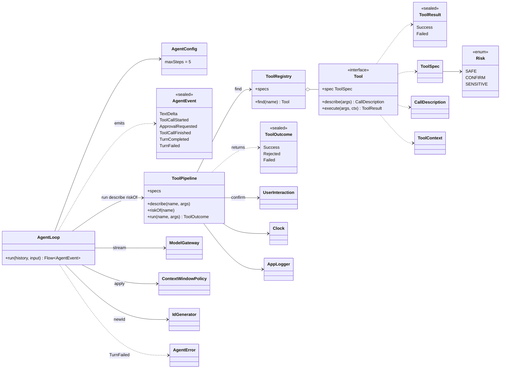
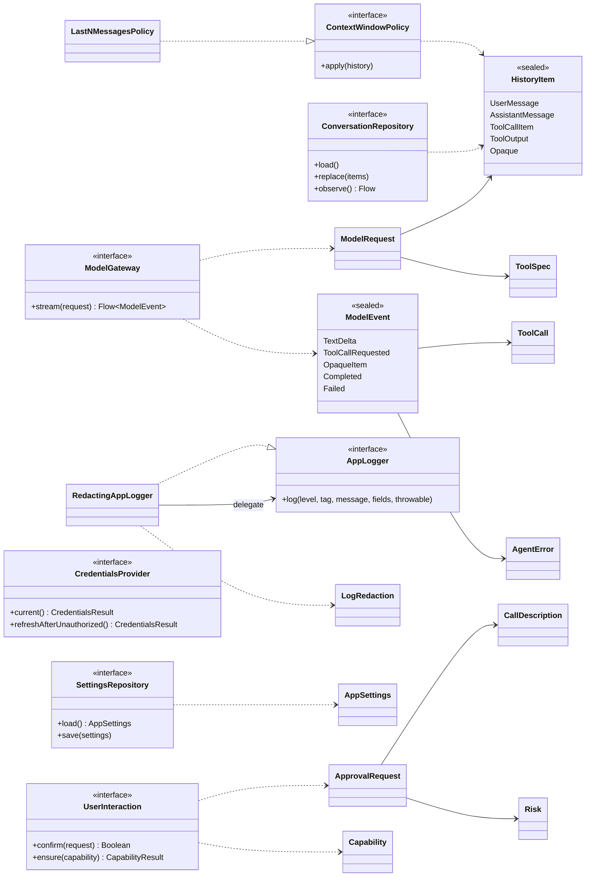
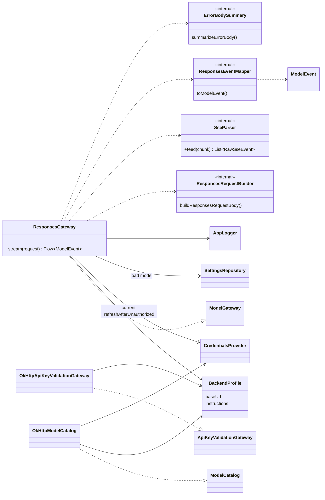

# Карта архитектуры: ядро и клиент модели

> Снимок 2026-09-24: `файл:строка` устарели (T8, T9, «Стык»). Верить коду и [overview](overview.md).

> Карта: [обзор](map-overview.md) · **ядро и клиент модели** · [вход](map-auth.md) · [tools и UI](map-tools-app.md) · [app](map-app-infra.md) · [потоки](map-flows.md). Раньше: [core](core.md), [adapters](adapters.md); здесь факты из кода и расхождения.

Стрелки: `..|>` реализует, `-->` держит и вызывает (параметр конструктора), `..>` использует или создаёт. Всё из `src/main`.

## `:core:domain`: агент и инструменты

## `:core:domain`: порты и модели

## `:core:domain`: роли

| Тип | Ответственность |
|---|---|
| `AgentLoop` | Один ход: запрос модели, вызовы инструментов строго по одному, повтор до ответа без вызовов, ошибки или `maxSteps=5`. Холодный `Flow`, отмена коллектора отменяет всё |
| `AgentEvent`, `AgentConfig` | События для ленты UI. `ApprovalRequested` только для не-`SAFE`; `TurnCompleted`/`TurnFailed` несут `newItems` |
| `AgentError` | Плоская sealed-иерархия ошибок без текстов (тексты в UI) |
| `ToolPipeline` | Единственный путь вызова: поиск, проверка `required`, подтверждение по `Risk`, `withTimeout` 5 с, обрезка вывода 4 КБ, лог |
| `ToolRegistry` | `Set<Tool>` в карту по имени; дубли имён = `require`-ошибка |
| `Tool`, `ToolSpec`, `Risk`, `CallDescription`, `ToolContext`, `ToolResult`, `ToolOutcome` | Контракт инструмента; `ToolResult` = что вернул инструмент, `ToolOutcome` = итог конвейера (`Rejected` = отказ пользователя) |
| `ModelGateway`, `ModelRequest`, `ModelEvent`, `Usage` | Порт модели: история и спецификации на входе, `Flow<ModelEvent>` на выходе, ошибки как `Failed` |
| `ModelCatalog` | Список моделей: `Available` или `Unavailable` |
| `ConversationRepository` | Одна история: `load`, `replace` (перезапись целиком), `observe` |
| `SettingsRepository`, `AppSettings` | Тема, модель, `searchFolderUri`. `useDynamicColors` и `useDarkTheme` сохраняются, но UI их не читает (`MainActivity` вызывает `AppTheme` с умолчаниями) |
| `UserInteraction`, `ApprovalRequest`, `Capability` | Порт вопросов пользователю: `confirm` и `ensure` (`NOTIFICATIONS`, `FILES`) |
| `CredentialsProvider`, `Credentials` | Токен и `accountId` для клиента модели, плюс `refreshAfterUnauthorized` |
| `ApiKeyValidationGateway` | Проверка API-ключа при входе |
| `HistoryItem`, `ToolCall` | История из 5 вариантов; `ToolCall.itemId` = id элемента у провайдера |
| `ContextWindowPolicy`, `LastNMessagesPolicy` | Сколько истории слать: `takeLast(n)` |
| `Clock`, `IdGenerator`, `DispatcherProvider` | Порты платформы. `DispatcherProvider` в main-коде не используется |
| `AppLogger`, `RedactingAppLogger`, `LogRedaction`, `RingLog` | Порт логов; декоратор с вырезанием токенов (`LogRedaction`); чистый кольцевой буфер строк |

`ToolFailure` и `Cancelled` в `AgentError` нигде в main не создаются, их только обрабатывает `ErrorPresentation`. `ModelEvent.OpaqueItem` не создаётся адаптером и игнорируется в `AgentLoop`.

## `:data:llm`

| Тип | Ответственность |
|---|---|
| `ResponsesGateway` | `channelFlow`: работа в `launch`, `awaitClose` отменяет HTTP-вызов; блокирующее чтение на `Dispatchers.IO`; при 401 один повтор после `refreshAfterUnauthorized`; нет токенов = `SessionExpired`; 403 = `Forbidden`, 429 = `RateLimited`, прочее = `Server(code)`, `IOException` = `Offline`/`Timeout` |
| `BackendProfile` | Только `baseUrl` и `instructions` (`SYSTEM_PROMPT`); один профиль `ChatGptSubscription` |
| `ResponsesRequestBuilder.kt` | `HistoryItem` → тело запроса: `store=false`, `stream=true`, `reasoning.effort=low`, `parallel_tool_calls=false`, `include reasoning.encrypted_content` |
| `SseParser`, `ResponsesEventMapper.kt` | Разбор `event:`/`data:`; кадр → `ModelEvent`: текст, `function_call`, `completed`, `error`. Прочее отбрасывается, ошибка разбора = `ProtocolChanged` |
| `ErrorBodySummary.kt`, `dto/` | Безопасное для лога описание тела ошибки; `internal` DTO |
| `OkHttpModelCatalog` | `GET {baseUrl}/models?client_version=`, разбор `slug` или `id` |
| `OkHttpApiKeyValidationGateway` | `GET {baseUrl}/models` с ключом: 200 = `Valid`, 401/403 = `Rejected` |

## Расхождения с существующими `docs/architecture/*.md`

| Документ | Написано | В коде |
|---|---|---|
| [core](core.md) | `AgentLoop` = автомат с чистой `reduce(state, event)` | Императивный `flow { while (true) }` без `reduce` и состояний |
| [core](core.md) | Конвейер из ступеней `ValidateArgs → ApprovalPolicy → Timeout → RunTool → Truncate → Log`, валидация по схеме | Один класс `ToolPipeline`; проверяется только наличие `required`, остальное валидируют сами инструменты |
| [core](core.md), [recipes](recipes.md) | `TypedTool<A>`, DSL схем | Нет; схемы вручную через `buildJsonObject` в каждом инструменте |
| [core](core.md) | `AgentError` по группам, есть `Tool.Validation`, `PermissionDenied` | Плоская; есть `ToolFailure`, `Interrupted`; `Validation` и `PermissionDenied` нет |
| [core](core.md) | В ядре `AuthProvider`, `Session`, `AuthState`, `AuthMethod` | В ядре только `CredentialsProvider`, `Credentials*`, `ApiKeyValidationGateway`; остальное в `:data:auth` |
| [adapters](adapters.md) | Два профиля (`PublicApi`), заголовки и модель в `BackendProfile`; `mapper/` | Один профиль; модель и заголовки в `ResponsesGateway`; маппер лежит в `sse/` |
| [adapters](adapters.md) | `AuthInterceptor` и `Authenticator` для 401 | Ретрай 401 в `ResponsesGateway`, интерсепторов нет |
| [adapters](adapters.md), [patterns](patterns.md) | Провайдеры входа через `@IntoMap` | Явный `mapOf` в `SessionAssemblyModule` |
| [adapters](adapters.md) | `:tools`: `common/`, всё `internal`, один `find_files` | Нет `common/`; часть типов `public`; два файловых инструмента (`find_files`, `search_files`, ADR 0003) |
| [adapters](adapters.md) | Room: `MessageEntity`, `conversationId` в API | Одна таблица `conversation_history`, API без `conversationId`, `exportSchema=false`, миграций нет |
| [patterns](patterns.md) | Диспетчеры не хардкодим, тяжёлое уходит на IO внутри типа | `Dispatchers.IO` в 7 местах; SAF-обход в `FindFilesTool` без IO |
| [ui](ui.md) | `UiMessage(User, Assistant(text, streaming), ToolCard)` | `ChatMessage(id, role, text, toolCall)`, поля `streaming` нет |
