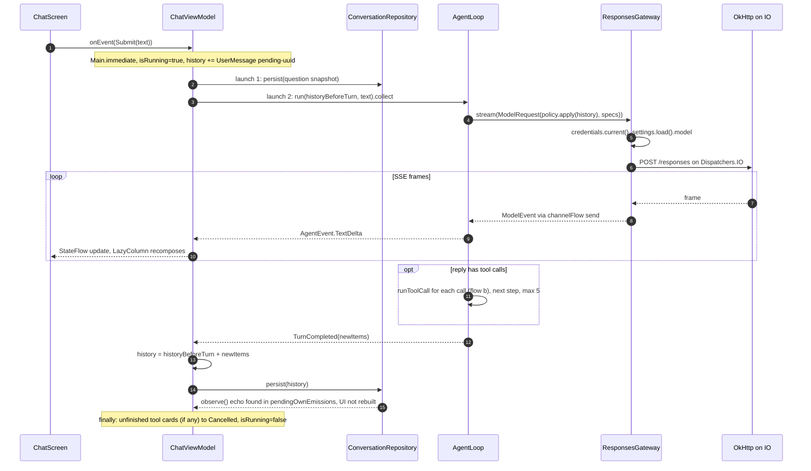
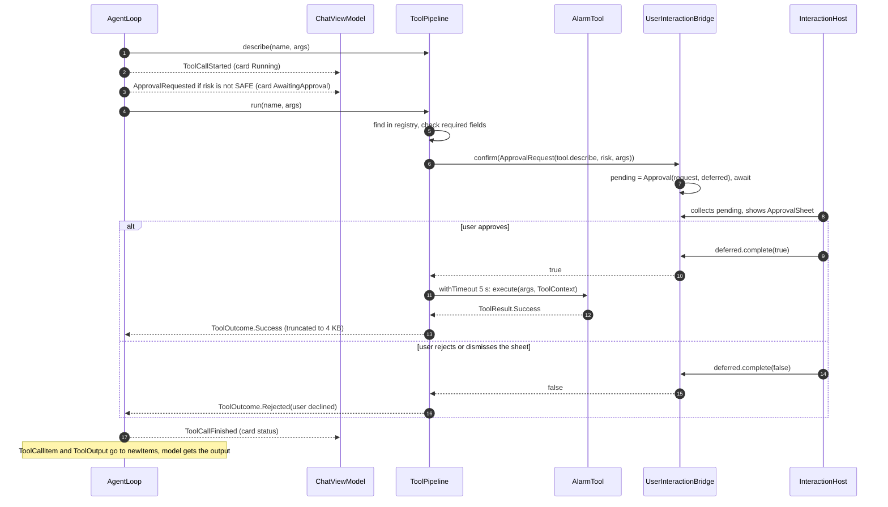
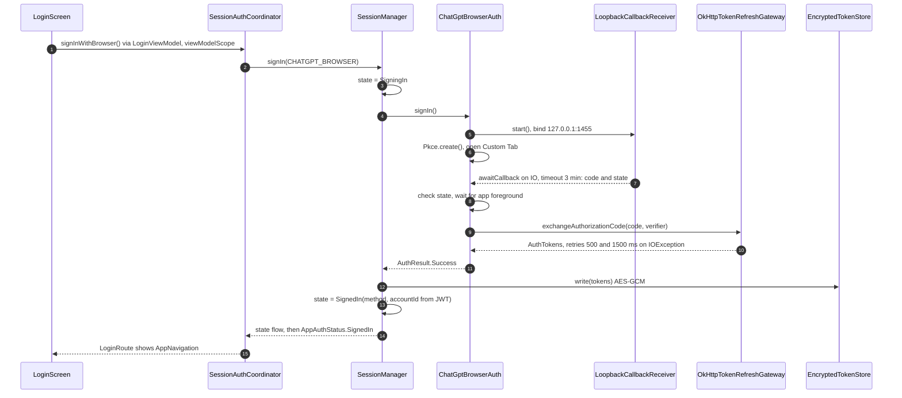
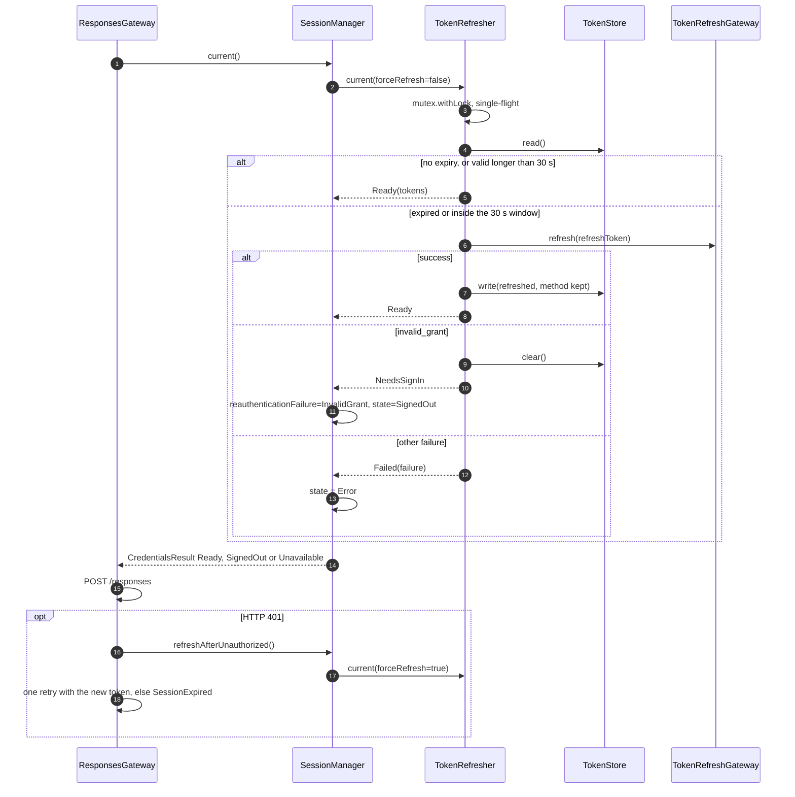
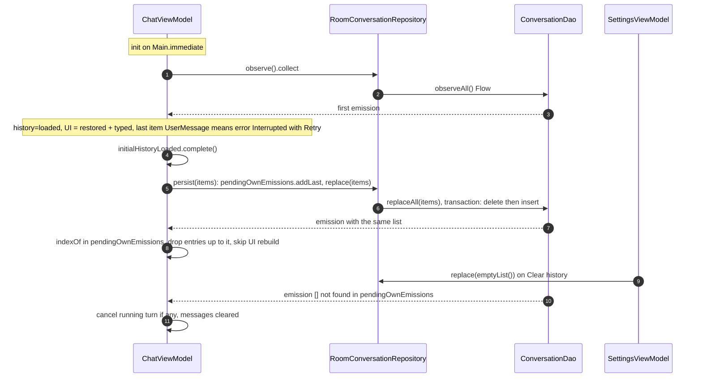
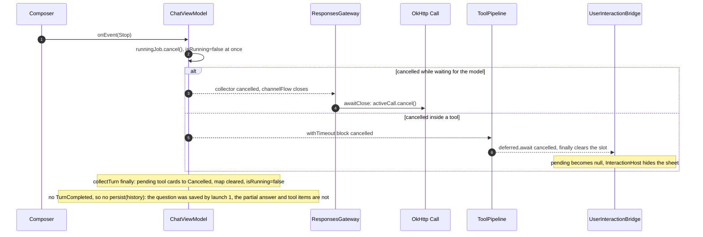

# Карта архитектуры: потоки выполнения

> Снимок 2026-09-24: `файл:строка` устарели (T8, T9, «Стык»). Верить коду и [overview](overview.md).

> Карта: [обзор](map-overview.md) · [ядро](map-core-data.md) · [вход](map-auth.md) · [tools и UI](map-tools-app.md) · [app](map-app-infra.md) · **потоки**. Только то, что есть в `main`; пакетного подтверждения нет.

## Потоки и диспетчеры

| Что | Где выполняется | Откуда |
|---|---|---|
| `viewModelScope` трёх ViewModel, сбор `AgentLoop.run`, `ToolPipeline`, `Tool.execute` | Main.immediate (диспетчер коллектора) | `ChatViewModel.kt:146-154` |
| HTTP модели, каталог, ключ, token endpoint, device code, `accept()` loopback | `withContext(Dispatchers.IO)` | `ResponsesGateway.kt:125`, `OkHttpModelCatalog.kt:32`, `OkHttpTokenRefreshGateway.kt:55`, `ChatGptBrowserAuth.kt:101` |
| MediaStore (`search_files`) | `Dispatchers.IO` | `SearchFilesTool.kt:93` |
| SAF-обход (`find_files`) | без переключения, то есть Main | `FindFilesTool.kt:87` |
| `SessionAuthCoordinator.state` | `applicationScope` = Main.immediate | `AuthBindingsModule.kt:98` |
| Room, DataStore | собственные исполнители библиотек | `RoomConversationRepository`, `PreferencesSettingsRepository` |
| Запись лога | поток вызывающего, синхронно | `AndroidLogcatLogger.kt:61-66` |

## (а) Один ход чата

Ошибка модели = `ModelEvent.Failed`, цикл отдаёт `TurnFailed(error, newItems)`; ViewModel сохраняет историю и показывает ошибку через `toPresentation()`. Исключение из цикла или инструмента ловит `collectTurn` (`ChatViewModel.kt:205-210`) и предлагает повтор.

Гонки и хрупкие места:
- `ChatViewModel.kt:32-58`: `history`, `historyBeforeTurn`, `toolMessageIdByCallId`, `pendingOwnEmissions` без синхронизации; верно, пока всё на Main.immediate.
- `:146-154`: два независимых `launch` (сохранить вопрос, выполнить ход). Порядок двух `replace()` держится на очереди Room; при мгновенной ошибке ход может записаться раньше вопроса. Гипотеза.
- `ResponsesGateway.kt:71,103`: `prompt_cache_key` новый на каждый `stream()`, то есть на каждый шаг, а не на диалог. Гипотеза о потере кэша промпта.
- `ResponsesGateway.kt:74-95`: `channelFlow` шлёт с IO-потока, коллектор читает на Main.

## (б) Вызов инструмента с подтверждением

Для `SAFE`-инструментов ветки подтверждения нет. `NotifyTool` и `SearchFilesTool` внутри `execute` зовут `bridge.ensure(capability)`: `InteractionHost` запускает системный запрос разрешения, ответ приходит через `deferred`. Текст подтверждения строится из `Tool.describe`, не из ответа модели. Неизвестный инструмент и ошибка аргументов дают `ToolOutcome.Failed`; модель получает `Failed: ...`.

Гонки и хрупкие места:
- `ToolPipeline.kt:85`, `NotifyTool.kt:59`, `SearchFilesTool.kt:78`: диалог разрешения внутри `withTimeout(5 с)` (наблюдение 1 в [обзоре](map-overview.md)).
- `UserInteractionBridge.kt:50,60`: один слот; второй параллельный вопрос затрёт первый. Сейчас вызовы идут по одному.
- `AgentLoop.kt:96-98`: `ApprovalRequested` уходит до `run()`; при `Failed` по аргументам окна не будет, карточка останется в `AwaitingApproval` до `ToolCallFinished`. Гипотеза, косметика.
- `ChatViewModel.kt:56-58`: `ApprovalRequested` без id привязан к последнему стартовавшему вызову; верно при последовательных вызовах.
- `InteractionHost.kt:27-29`: пересоздание Activity отклоняет открытое подтверждение.

## (в) Вход и обновление токена

Другие способы: device code (запрос кода, `prompt` для UI, опрос до 15 мин, тот же обмен кода) и `API_KEY` (проверка `GET /models`). При старте `LoginViewModel.init` вызывает `restore()`.

Гонки и хрупкие места:
- `TokenRefresher.kt:29-52`: `Mutex` защищает только refresh; `SessionManager.kt:63` (`write`) и `:82` (`clear`) вне него (наблюдение 7).
- `SessionManager.kt:50-79`: нет защиты от повторного `signIn` (UI блокирует кнопки по `isLoading`). `LoopbackCallbackReceiver` синглтон с полем `serverSocket` (`ChatGptBrowserAuth.kt:79`): второй параллельный `start()` закрыл бы сокет первого. Гипотеза.
- `ResponsesGateway.kt:97-116`: один повтор после 401; второй 401 = `SessionExpired`.
- `SessionAuthCoordinator.kt:98`: `pendingKey` без синхронизации между `setKey` и `signIn`.

## (г) Сохранение и восстановление истории

Своя запись узнаётся по равенству всего списка (`ChatViewModel.kt:65-69`). Чужая (очистка из настроек) перестраивает ленту и отменяет идущий ход (`:70-75`). Ошибка записи: запись убирается из `pendingOwnEmissions`, `saveFailed=true`, показывается ошибка (`:176-194`). Ошибка `observe()` (битая строка): `Unexpected` в состоянии, лента пуста.

Гонки и хрупкие места:
- `ChatViewModel.kt:53,69,187`: `pendingOwnEmissions` чистится только совпадением или ошибкой записи; если Room объединит эмиссии или запись отменят после коммита, останутся лишние элементы `[проверить]`.
- `ConversationDao.kt:25-30`: каждое сохранение перезаписывает всю таблицу транзакцией `deleteAll` + `insertAll`.
- Сохранение только в `TurnCompleted`/`TurnFailed` (`ChatViewModel.kt:201`); убитый процесс оставляет вопрос без ответа, при старте это `Interrupted`.

## (д) Стоп

`CancellationException` везде пробрасывается (`collectTurn`, `ResponsesGateway`, `ToolPipeline` ловит только `TimeoutCancellationException`).

Гонки и хрупкие места:
- `ChatViewModel.kt:105-110` против `:211-216`: `isRunning=false` ставится сразу, а `finally` отменённой корутины сбрасывает его и `toolMessageIdByCallId` позже; новый `submit` между ними попадёт под сброс (наблюдение 9).
- `FindFilesTool.kt:87`, `SafTreeWalker.kt:52`: SAF-обход не проверяет отмену и идёт на Main, Stop его не прервёт.
- `ChatViewModel.kt:201`: экран остаётся с частичным ответом, на диске его нет; после перезапуска виден только вопрос.
