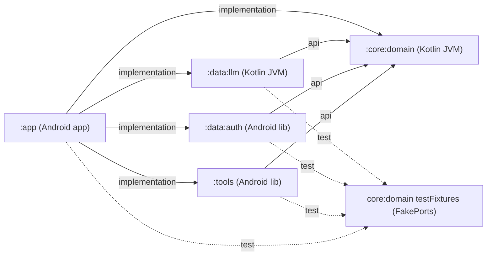
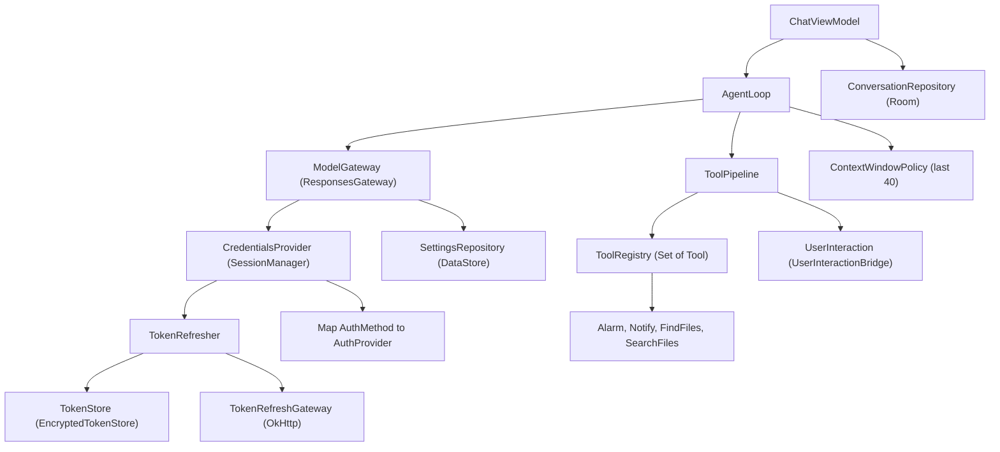

# Карта архитектуры: обзор

> Снимок 2026-09-24: `файл:строка` устарели (T8, T9, «Стык»). Верить коду и [overview](overview.md).

> Карта: **обзор** · [ядро](map-core-data.md) · [вход](map-auth.md) · [tools и UI](map-tools-app.md) · [app](map-app-infra.md) · [потоки](map-flows.md). Раньше: [overview](overview.md), [core](core.md), [adapters](adapters.md).

Карта для ревью по схеме, без чтения всего кода. Снята с `src/main` на коммите `31415f3` (в `main` дальше только два CI-коммита), тесты не описаны. Факт = подтверждён кодом (импорты, конструкторы, `@Binds`/`@Provides`); `[проверить]` = чтением не подтверждено. Расхождения со старыми docs: в конце [map-core-data](map-core-data.md).

## Граф модулей (сверено с Gradle)

Сверка с `*/build.gradle.kts` и `build-logic/`: связи совпадают с [overview](overview.md). Адаптеры друг от друга не зависят и встречаются только в DI `:app`: `ApiKeyAuth` (`:data:auth`) берёт порт `ApiKeyValidationGateway`, реализация `OkHttpApiKeyValidationGateway` лежит в `:data:llm`. Уточнения: `:app` подключает OkHttp напрямую (DI создаёт клиенты); Hilt только в `:tools` и `:app`; `explicitApi()` в JVM- и library-плагинах, для `:app` нет.

## Модули

| Модуль | Ответственность | Главные типы |
|---|---|---|
| `:core:domain` | Порты, модели, цикл агента, конвейер инструментов, ошибки, редактирование логов. Без Android, OkHttp, DI | `AgentLoop`, `AgentEvent`, `AgentError`, `ToolPipeline`, `ToolRegistry`, `Tool`, `Risk`, `ModelGateway`, `UserInteraction`, `ConversationRepository`, `SettingsRepository`, `CredentialsProvider`, `HistoryItem`, `AppLogger` |
| `:data:llm` | Клиент Responses API, SSE, изоляция формата бэкенда | `ResponsesGateway`, `BackendProfile`, `OkHttpModelCatalog`, `OkHttpApiKeyValidationGateway`; `internal`: `buildResponsesRequestBody`, `SseParser`, `toModelEvent`, DTO |
| `:data:auth` | Вход (браузер+PKCE, device code, API-ключ), токены, refresh | `SessionManager`, `TokenRefresher`, `TokenStore`, `EncryptedTokenStore`, `AuthProvider`, `TokenRefreshGateway`, `AuthConfig`, `AuthState` |
| `:tools` | Инструменты телефона, Android-обёртки, регистрация `@IntoSet` | `internal`: `AlarmTool`, `NotifyTool`, `FindFilesTool`, `SearchFilesTool`, `*Bindings`; `public`: `AlarmArgs`, `NotifyArgs`, `AlarmIntentFactory`, `validate*Args` |
| `:app` | Composition root: DI, Compose UI, Room, DataStore, мост диалогов, логи, координатор входа | `ChatViewModel`, `UserInteractionBridge`, `SessionAuthCoordinator`, `RoomConversationRepository`, `PreferencesSettingsRepository`, `AndroidLogcatLogger` |

## Карта DI (Hilt, всё в `SingletonComponent`)

| Hilt-модуль (`app/.../di/`) | Что связывает |
|---|---|
| `AgentBindingsModule`, `AgentModule` | `UserInteractionBridge` → `UserInteraction`; `IdGenerator`; `ToolRegistry(Set<Tool>)`; `ToolPipeline` (таймаут по умолчанию 5 с); `AgentLoop` (без scope, новый на каждую инъекцию) |
| `ModelModule` | `OkHttpModelCatalog` → `ModelCatalog` (свой `OkHttpClient()`); `ResponsesGateway` → `ModelGateway` (свой клиент, read 60 с); `LastNMessagesPolicy(40)` → `ContextWindowPolicy` |
| `Settings*Module` (2), `Conversation*Module` (2) | `PreferencesSettingsRepository` → `SettingsRepository` (DataStore `app_settings`); `RoomConversationRepository` → `ConversationRepository`, `AppDatabase` (`phone-agent.db`), `ConversationDao` |
| `AuthBindingsModule` | `SessionAuthCoordinator` → `AuthCoordinator`; `SessionManager` → `CredentialsProvider` |
| `AuthNetworkModule` | общий `OkHttpClient()`; `AuthConfig` и `BackendProfile` (обе `ChatGptSubscription`); `TokenRefreshGateway`, `ApiKeyValidationGateway`, `DeviceCodeGateway` |
| `AuthRuntimeModule` | `CoroutineScope(SupervisorJob + Main.immediate)`; `Clock`; `TokenStore`; `CallbackReceiver`; `BrowserLauncher`; `ChatGptBrowserAuth`; `ChatGptDeviceCodeAuth`; `ApiKeyAuthFactory`; `TokenRefresher` |
| `SessionAssemblyModule` | `AppLogger` = `RedactingAppLogger(AndroidLogcatLogger)`; `Map<AuthMethod, AuthProvider>` (явный `mapOf`, не `@IntoMap`); `SessionManager` |
| `AlarmBindings`, `NotifyBindings`, `FilesBindings` (`:tools`, `internal`) | `@IntoSet Tool` для 4 инструментов; `Notifier`, `MediaStoreSearch`, `SelectedFolder` |

Через `@Inject` без модуля: `UserInteractionBridge`, `SessionAuthCoordinator`, `MutableApiKeyAuthProvider`, инструменты и их обёртки, три `@HiltViewModel`. `AppLogger` и `Clock` объявлены в файле Auth-модулей, хотя нужны всем.

## Точки входа

- `AndroidManifest.xml`: `PhoneAgentApplication` и единственная `MainActivity` (LAUNCHER, без `configChanges`); сервисов, ресиверов, провайдеров нет. Разрешения: `INTERNET`, `POST_NOTIFICATIONS`, `SET_ALARM`, `READ_EXTERNAL_STORAGE` (до API 32), `READ_MEDIA_*`.
- `PhoneAgentApplication` (`@HiltAndroidApp`): ставит `crashLoggingHandler` с `AppLogger`.
- `MainActivity` (`@AndroidEntryPoint`): `AppTheme { LoginRoute(authenticatedContent = AppNavigation); InteractionHost(bridge) }`.
- `LoginRoute` → `LoginViewModel` → `AuthCoordinator.restore()` в `init`; пока не `isSignedIn`, показывает `LoginScreen`.
- `AppNavigation`: Navigation 3, `AppDestination.Chat` и `Settings`, стек в `remember`. `ChatRoute` → `ChatViewModel`; `SettingsRoute` → `SettingsViewModel` и выбор папки (`OpenDocumentTree`).

## Автоматические правила (Konsist)

`app/src/test/kotlin/com/example/phoneagent/architecture/ArchitectureTest.kt` (Konsist) смотрит только `*/src/main/*`, по импортам и тексту файла. 12 правил: нет `GlobalScope`/`runBlocking`/`Thread.sleep`; `android.util.Log` только в `AndroidLogcatLogger`; `core/domain` не импортирует `android*`, `okhttp3`, `dagger`, `data.*`, а `data/llm` не импортирует `android*`, `dagger`, `data.auth`; `ui/` не импортирует `data.*`, `tools.*`; `designsystem` не импортирует `ui.chat`, `ui.navigation`; нет загрузчика картинок; markdown-библиотека только в `AssistantMarkdown`; сообщения логов без интерполяции; `Color(0x` только в theme, нет `Text("...")`; ViewModel не импортирует `Activity`/`Context`/`View`; пакеты `:tools` не импортируют друг друга; реализации `Tool` лежат в `:tools` и названы `*Tool`.

Не покрыто: жёсткий `Dispatchers.*`, `RandomIdGenerator` мимо порта.

## Наблюдения автора (гипотезы для ревью)

Подсказки, не приговор. «Проверено» = видно в коде; «гипотеза» = вывод по коду.

1. `ToolPipeline.kt:85`, `NotifyTool.kt:59`, `SearchFilesTool.kt:78`, `AgentModule.kt:50`: `withTimeout(5 с)` охватывает `tool.execute`, а инструменты внутри вызывают `UserInteraction.ensure()` (системный диалог разрешения). Ответ дольше 5 с даёт `Failed("timed out…")`, ответ на диалог теряется. Проверено чтением, на устройстве не воспроизводилось.
2. `FindFilesTool.kt:73,87`, `SafDocumentNode.kt:24`, `ChatViewModel.kt:150`: блокирующий обход SAF без `withContext(IO)`, а цикл агента собирается в `viewModelScope` (Main.immediate): до 5 с на главном потоке, `withTimeout` блокирующий код не прерывает. `SearchFilesTool.kt:93` уходит на IO. `DispatcherProvider` в main не используется, `Dispatchers.IO` зашит в 7 местах (против patterns.md). Проверено.
3. `ChatViewModel.kt` (308 строк): ход агента, синхронизация истории с Room (`pendingOwnEmissions`), retry, маппинг событий, статусы карточек. `:143` берёт `RandomIdGenerator` мимо порта `IdGenerator`. Порог recipes.md (~300 строк) превышен. Проверено.
4. Решено: `SearchFilesTool` отдаёт и восстанавливает `ToolContent`; UI его отображает без имени инструмента и разбора JSON. Текст истории и Room не изменены.
5. `InteractionHost.kt:27-29`, `AndroidManifest.xml:34`, `AppNavigation.kt:20`: пересоздание Activity (поворот, смена темы) при открытой шторке подтверждения = тихий отказ (`resolvePendingAsDeclined`); стек навигации в `remember`, а не в saveable: из Настроек после поворота возврат в Чат. Проверено.
6. `UserInteractionBridge.kt:50,60`: один слот `MutableStateFlow`; второй параллельный `confirm`/`ensure` затрёт первый, тот повиснет. Сегодня безопасно (инструменты идут по одному), инвариант нигде не закреплён. Гипотеза.
7. `SessionManager.kt:63,82` против `TokenRefresher.kt:29-38`: `write`/`clear` идут вне `Mutex` рефрешера, refresh «в полёте» может записать токены после `signOut`. `TokenRefresher.kt:38` не сохраняет старый `refreshToken`, если сервер его не вернул (следующий refresh даст `NeedsSignIn`). `SessionManager.kt:102-108`: `SignedOut` (токенов нет) трактуется как `NeedsSignIn`, в отличие от `restore()`. Механизмы проверены, поведение сервера нет.
8. `ConversationDao.kt:25-30`, `ChatViewModel.kt:53,65-69,176-201`, `HistoryItemEntityMapper.kt:107`: каждое сохранение = delete+insert всей таблицы; свои записи узнаются сравнением списков целиком, устаревшие пункты `pendingOwnEmissions` чистятся только по совпадению (если Room склеит эмиссии, возможны остатки, `[проверить]`); при Stop частичный ответ и вызовы не сохраняются; битая строка ломает весь `observe()`. Проверено.
9. `ChatViewModel.kt:105-110` против `:211-216`: Stop сразу ставит `isRunning=false` и разрешает новый `submit`, а `finally` старой корутины позже снова сбрасывает `isRunning` и чистит `toolMessageIdByCallId`. Окно узкое (Main.immediate). Гипотеза.
11. `ResponsesEventMapper.kt:44`, `ResponsesRequestBuilder.kt:44`, `AgentLoop.kt:85`: запрос просит `reasoning.encrypted_content`, а маппер отбрасывает всё, кроме `function_call`; `ModelEvent.OpaqueItem` и `HistoryItem.Opaque` никто не создаёт. Если бэкенд потребует вернуть reasoning на втором шаге, вызов инструмента может упасть `[проверить]` (вопрос открыт в backend-notes.md).
12. `SessionManager.kt:81-86`: `signOut` чистит только токены; история Room остаётся (возможно, и `ChatViewModel` в памяти, см. [map-app-infra](map-app-infra.md)). Намерение неизвестно. Проверено.
