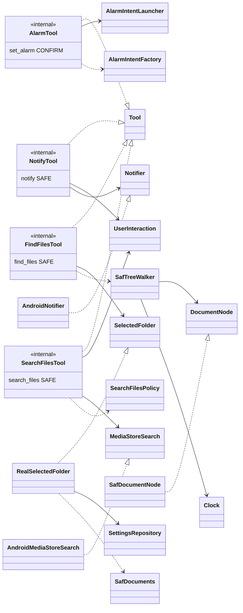
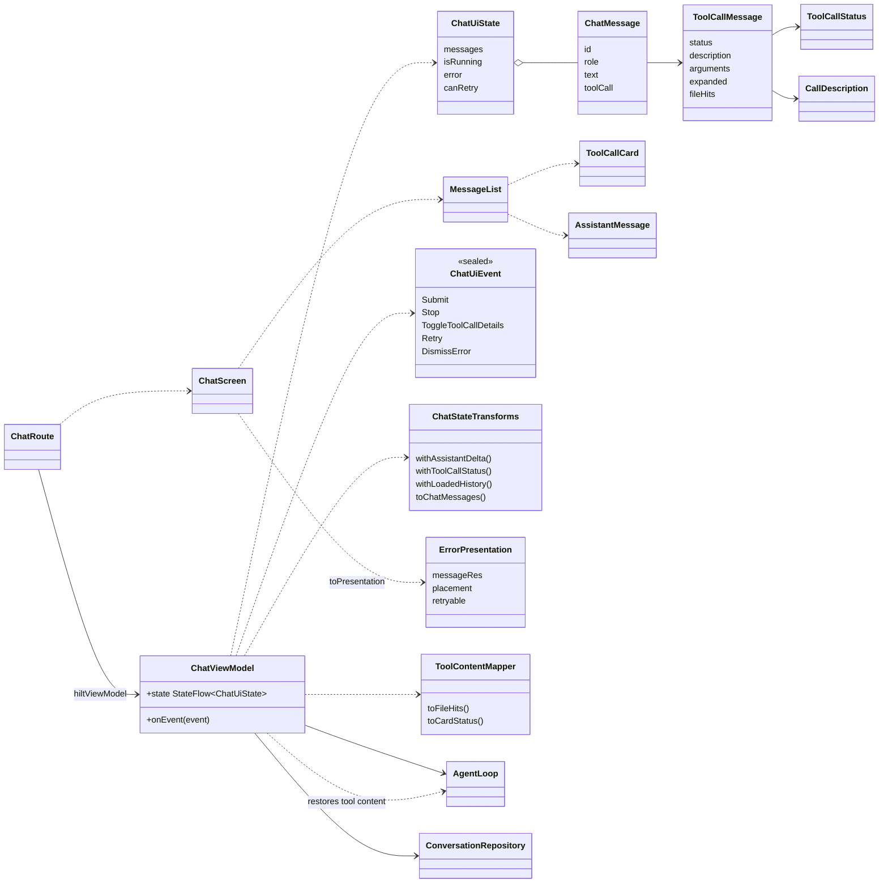

# Карта архитектуры: инструменты и UI чата

> Снимок 2026-09-24: `файл:строка` устарели (T8, T9, «Стык»). Верить коду и [overview](overview.md).

> Карта: [обзор](map-overview.md) · [ядро](map-core-data.md) · [вход](map-auth.md) · **tools и UI** · [app](map-app-infra.md) · [потоки](map-flows.md). Раньше: [adapters](adapters.md), [ui](ui.md), [design/components](../design/components.md).

## `:tools`

| Инструмент | `Risk` | Логика без Android | Android-обёртка | Заметки |
|---|---|---|---|---|
| `AlarmTool` `set_alarm` | `CONFIRM` | `AlarmIntentFactory`, `validateAlarmArgs` | `AlarmIntentLauncher`: `startActivity(SET_ALARM)` с `NEW_TASK` из application context | Запрос уходит в приложение «Часы», факт создания будильника не проверяется |
| `NotifyTool` `notify` | `SAFE` | `validateNotifyArgs` (заголовок до 100, текст до 500) | `AndroidNotifier`: канал `phone_agent_notifications`, `NOTIFICATION_ID=1` | Сам зовёт `UserInteraction.ensure(NOTIFICATIONS)`; новое уведомление заменяет прежнее |
| `FindFilesTool` `find_files` | `SAFE` | `SafTreeWalker`: обход в ширину (глубина 6, 5000 узлов, 5 с, 20 совпадений), `FindFilesArgs` | `RealSelectedFolder` (папка из `AppSettings.searchFolderUri`), `SafDocumentNode`, `SafDocuments` | Возвращает имена и относительные пути; нет папки = `Failed` |
| `SearchFilesTool` `search_files` | `SAFE` | `SearchFilesPolicy`: дедуп по имени и размеру, 20 записей, JSON до 3500 байт; `SearchFilesArgs` | `AndroidMediaStoreSearch`: `Files` и `Downloads`, `LIKE` по `DISPLAY_NAME` | Сам зовёт `ensure(FILES)`; отдаёт `content://` URI и метаданные (ADR 0003) |

Общее: каждый инструмент строит схему вручную, декодирует аргументы `kotlinx.serialization`, `describe()` даёт `CallDescription` для карточки и шторки. Русские тексты лежат в `*Copy.kt` (не в `strings.xml`). Регистрация: `@Binds @IntoSet` в `AlarmBindings`, `NotifyBindings`, `FilesBindings` (все `internal`).

## `:app`: UI чата

| Тип или файл | Ответственность |
|---|---|
| `ChatRoute`, `ChatScreen` (`ChatScreen.kt`) | Route берёт `ChatViewModel` и открывает файл или ссылку (`OpenFile.kt`, `OpenLink.kt`); Screen stateless: топ-бар, лента, ошибка, `Composer`; черновик в `rememberSaveable` |
| `ChatViewModel` | Состояние чата; запуск `AgentLoop` в `viewModelScope`; сохранение истории; `Stop`, `Retry`; `AgentEvent` → `ChatUiState` |
| `ChatContract.kt` | `ChatUiState`, `ChatMessage`, `ToolCallMessage`, `ChatRole`, `ChatUiEvent` |
| `ChatStateTransforms.kt` | Чистые функции над `ChatUiState`; `withLoadedHistory` помечает незавершённый ход как `Interrupted` |
| `ErrorPresentation.kt` | Единственное место `AgentError` → строка, место показа и `retryable`; `when` без `else` |
| `ToolContentMapper.kt` | Преобразует доменный `ToolContent` в модель карточки; протокол инструмента и JSON не разбирает |
| `SearchFilesTool.restoreContent()` | Восстанавливает типизированные метаданные из прежнего JSON вывода; формат текста истории не меняется |
| `MessageList.kt`, `FeedFollow.kt` | Обратная `LazyColumn`; логика «следовать за новым» и чип «к новым» вынесена в чистые функции |

### `ui/designsystem`

Не знает про экраны (правило Konsist). Импортирует типы ядра: `ToolCallCard` берёт `CallDescription`, `ApprovalSheet` берёт `ApprovalRequest`.

| Часть | Что внутри |
|---|---|
| `theme/` | `AppTheme(darkTheme, useDynamicColor)` (светлая и тёмная схемы, динамический цвет с Android 12, `AppSpacing`, `AppExtendedColors`, `AppMonospace`), `Color.kt` |
| `icons/` | `AppIcons` (ресурсы иконок) |
| `components/` | `ApprovalSheet`, `AssistantMarkdown` (единственный вход в markdown-библиотеку, картинки отключены), `Composer`, `EmptyState`, `InlineError`, `StatusBanner`, `Messages` (`UserMessage`, `AssistantMessage`), `ToolCallCard`, `ToolCallStatus`, `FileHit`, `LinkDecision` (`evaluateLink`: только https), `LinkConfirmationSheet`, `FileOpenConfirmationSheet`, `ScrollToBottomChip`, `StreamingFence` (закрывает незакрытый code fence); 9 файлов `*Preview.kt` |

## Самые большие файлы `:app` и `:tools` (`wc -l`, только `src/main`)

| Файл | Строк | Главная ответственность |
|---|---|---|
| `app/.../ui/chat/ChatViewModel.kt` | 308 | Ход агента, синхронизация с Room, retry и Stop, маппинг событий в UI |
| `app/.../ui/designsystem/components/ToolCallCard.kt` | 288 | Карточка вызова: статусы, аргументы, чипы найденных файлов, шторка открытия |
| `app/.../ui/settings/SettingsScreen.kt` | 265 | Экран настроек: аккаунт, модель, папка поиска, очистка истории |
| `app/.../ui/login/LoginScreen.kt` | 263 | `LoginRoute` и экран входа: браузер, device code, API-ключ |
| `app/.../ui/settings/SettingsViewModel.kt` | 189 | Настройки, каталог моделей, статус входа, очистка истории, выход |
| `app/.../ui/chat/MessageList.kt` | 186 | Лента, автопрокрутка, чип «к новым» |
| `app/.../di/AuthBindingsModule.kt` | 186 | Четыре Hilt-модуля: сеть, рантайм входа, логгер и сессия |
| `app/.../ui/designsystem/components/ApprovalSheet.kt` | 182 | Шторка подтверждения по `ApprovalRequest` |
| `app/.../ui/chat/ChatScreen.kt` | 178 | `ChatRoute`, `ChatScreen`, индикатор работы, ошибки |
| `tools/.../files/MediaStoreSearch.kt` | 175 | Адаптер `MediaStore` для `search_files` |

Дальше в `:tools`: `FindFilesTool.kt` 142, `SearchFilesTool.kt` 133, `SafTreeWalker.kt` 132, `SearchFilesPolicy.kt` 131. Всего в `src/main`: `:app` 5467, `:core:domain` 809, `:data:llm` 738, `:data:auth` 1332, `:tools` 1523 строк.
